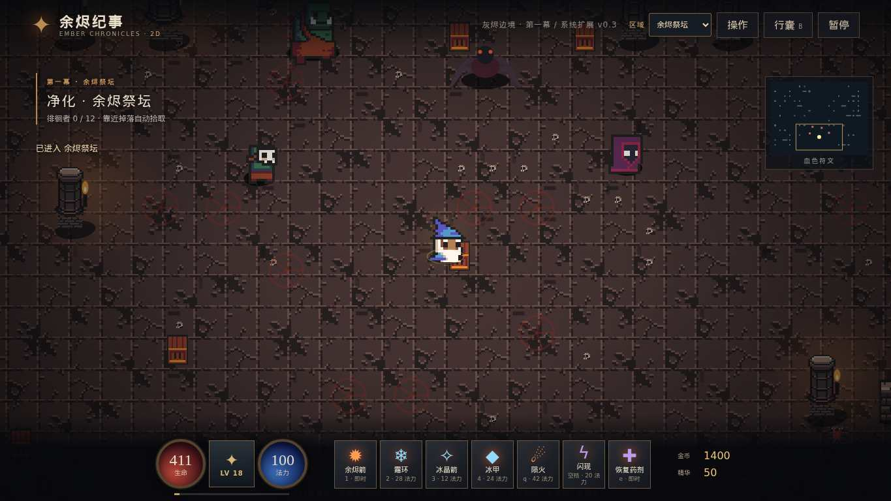

# 余烬法师 · Ember Mage

> **2D 试玩迭代（v0.3.3）**：采用 Canvas 2D 俯视角渲染，无需加载 Three.js / GLB 模型。与原 3D 版并行维护，互不覆盖。
>

> **v0.3.3 开发预览**：清晰的原创 Canvas 法师模型（披风、头盔和法杖配色随装备变化）、新增 4 个可用法术至 11 个、可配置 7 槽技能快捷栏、默认关闭的自动/批量分解、三种分解材料及装备词缀淬炼。已装备、收藏、传奇和套装不会被自动回收。详见 [v0.3.3 验收记录](docs/2D-V0.3.3-ACCEPTANCE.md)。**本版仍属试玩性质，写实暗黑 A 方向的迷宫、场景和怪物尚在重构。**
>
> **v0.3.3 Chromium 实机画面**：[PC 新法师与场景](docs/screenshots/2d-v0.3.3-game-desktop.jpg) · [手机实机画面](docs/screenshots/2d-v0.3.3-game-mobile.jpg) · [PC 自动分解与锻造界面](docs/screenshots/2d-v0.3.3-crafting-desktop.jpg) · [手机自动分解界面](docs/screenshots/2d-v0.3.3-crafting-mobile.jpg)。这些是真实的游戏浏览器截图，不是风格概念图。
>
> **v0.3.2 Demo 可玩更新**：区域从五张扩展到九张、四位新增独占掉落 Boss、每件装备类型都有匹配图形（法杖/剑/戒指/头盔/盾等），背包重做为左装备/中属性对比/右筛选，Boss 战后出现实际传送阵，可指定下一张或随机目的地，也可留在本层。修复长词缀溢出、减少频繁换装操作。详见 [v0.3.2 清单及限制](docs/2D-V0.3.2-ACCEPTANCE.md)。
>
> **真实 Chromium 测试截图（不是概念设计图）**：[PC装备背包](docs/screenshots/2d-v0.3.2-inventory-desktop.jpg) · [手机版背包](docs/screenshots/2d-v0.3.2-inventory-mobile.jpg) · [PC传送阵](docs/screenshots/2d-v0.3.2-portal-desktop.jpg) · [手机版传送阵](docs/screenshots/2d-v0.3.2-portal-mobile.jpg)。
>
> **仍未达成 A 方向写实 2.5D 最终视觉**：这次增加的是正确类别的原创矢量装备图标及实际操作体验；九个地图仍共享原型图块，真正的多房间迷宫仍在 PR #6 分支推进。
>
> **v0.3.1 即时反馈热修**：Boss 首杀必有专属传奇与普通装备，战后不再强制结束；没来得及拾取的 Boss 物品将随旧存档键保存。背包与 13 槽装备加入真实贴图图标，减少双击缩放误操作，五大区域的地面装饰按种子变化。此版本仍是低像素原型，美术距离用户确认的写实暗黑 2.5D 目标很远。
>
> [看真实浏览器 Boss 掉宝画面](docs/screenshots/2d-v0.3.1-boss-loot-desktop.jpg) · [看物品贴图背包](docs/screenshots/2d-v0.3.1-item-icons-desktop.jpg) · [手机版实际截图](docs/screenshots/2d-v0.3.1-boss-loot-mobile.jpg)

> **[直接体验 2D 版](https://templehao.github.io/Diablo/2d/)** · [2D 实现与测试说明](docs/2D-IMPLEMENTATION.md) · [2D 自动化检查](https://github.com/TempleHao/Diablo/actions/workflows/check-2d.yml)
>
> **v0.3 功能已接入游戏**：13 个装备槽、随机词缀与套装、80 格背包、等级与技能点、7 项战斗技能、5 个区域及更丰富的怪物遭遇。支持旧 2D 角色存档迁移。详见 [完整验收记录](docs/2D-SYSTEMS-V0.3.md)。
>
> **美术进度说明**：A 方向写实 2.5D 概念版式已作为最终目标，但当前 v0.3 实机仍使用有授权的像素精灵图，尚未达到最终美术验收；请以 [真实游戏截图](docs/screenshots/2d-v0.3-playtest-desktop.jpg) 而不是概念图判断当前效果。

> 2D v0.2 已使用 CC0 地牢精灵图集绘制动态人物、怪物、墙体及地面，并改进场景前后遮挡和开场遭遇战；详见 [素材来源及许可](docs/2D-ART-SOURCES.md)。游戏已实现法师移动、火球/霜环/闪现/药水、近战与远程怪物、首领、装备拾取、三槽换装、分解、等级与本机存档，支持键鼠和手机触摸操作。仍为第一幕战斗原型，完整剧情、多职业、打造与完整美术尚未实现。2D 存档独立于 3D 存档。

**2D v0.2 真实浏览器运行截图**（GitHub Actions 中的 Chromium，非概念图）：



[查看 13 槽装备词缀实测界面](docs/screenshots/2d-v0.3-inventory-desktop.jpg)

[查看新版 390×844 手机视口截图](docs/screenshots/2d-v0.3-playtest-mobile.jpg) · [查看产生截图的自动化测试](https://github.com/TempleHao/Diablo/actions/runs/38295741221)

当前 2D 美术是可玩且有动作帧的统一像素图集版本，仍与《暗黑破坏神 II 重制版》的高精度手工美术存在明显差距；不应误认为完整美术验收已结束。


**版本 0.3.0-preview.2** · 写实暗黑方向的3D美术预览；仍是单人刷怪原型。第一版专注法师，支持电脑与手机浏览器。

[打开游戏](https://templehao.github.io/Diablo/) · [完整游戏策划](docs/bible/README.md) · [在线策划阅读版](https://templehao.github.io/Diablo/design/) · [部署工作流](https://github.com/TempleHao/Diablo/actions/workflows/pages.yml)

游戏地址需要 GitHub Pages 工作流成功部署后才可访问；以工作流结果为准。

项目续做从[断点记录](docs/PROJECT-STATE.md)、[工作队列](docs/WORK-QUEUE.md)和[机器可读状态](docs/project-state.json)恢复。定时任务每5小时尝试继续；实际执行取决于额度、工具与连接可用，不代表能够查询或保证额度恢复时间。

## 完整故事与策划纲领

《余烬纪事》策划基线1.0已整理成[分章文档](docs/bible/README.md)、[完整Markdown](docs/GAME-BIBLE-1.0.md)与[PDF](dist/design/GAME-BIBLE-1.0.pdf)。源章节约11.0万汉字，覆盖五幕故事、法师三系、装备与词条、关卡与怪物、掉落打造、终局和未来在线扩展，并给出美术技术规范及验证方法。它是完整设计提案，与当前Demo实际能力分别标注。


## 当前可玩内容

- 法师采用连续人体网格、真实皮肤UV、可辨眼睛与手部、发卡、多层衣物和皮革胸带；Idle/Walk/Cast骨骼动作。人物面板支持全身/面部、拖转和滚轮/双指缩放；细节加载失败可重试，关闭不会阻断回到地窟。
- 灰烬地窟重做错缝缺角石板、风化石墙PBR、连续尖拱与断拱、浮雕/空兜帽石像、灰污潮迹和柔边火把，保留既有通路/碰撞。新增接触遮蔽与HDR输出照明。
- 火球远程攻击、冰霜新星范围伤害与减速、闪现、冷却式治疗药水。
- 12 名守卫与灰烬领主、三种品质随机法杖、升级、换装与分解。
- 本机存档保留等级、装备、通关次数；死亡保留已拾取成长，通关后下一轮敌人和掉落提高。
- 存档与备份面板：保留旧0.2.0角色和法杖，支持导出文件、导入前预览与确认、恢复备份。手动替换角色的恢复点与自动保存分开；坏档和高版本档会保护原文件，保存失败有提示。
- 手机左侧摇杆移动、右侧技能按钮；按住火球连续攻击，自动瞄准最近敌人。电脑支持键鼠。

## 操作

| 操作 | 电脑 | 手机 |
| --- | --- | --- |
| 移动 | WASD / 方向键 | 左侧摇杆 |
| 火球 | 鼠标瞄准，按住左键或 1 | 按住火球 |
| 冰霜新星 | 2 | 冰霜按钮 |
| 闪现 | 空格 | 闪现按钮 |
| 药水 | 3 | 药水按钮 |
| 装备 | B / 装备按钮 | 装备按钮 |
| 人物查看 | 人物按钮，拖动旋转 | 人物按钮，拖动旋转 |

建议手机横屏。页面需要 WebGL；所有游戏运行资源都随仓库部署，不依赖外部 CDN。

## 本地启动

需要 Python 3、Node.js 和支持 WebGL 的浏览器，不需要安装 npm 依赖。

```sh
npm run dev
# 浏览器打开 http://localhost:5173
npm run check
```

## 模型源文件

2026-10-13已单独修复源模型布尾两层的权重关系，并增加`--source-only`制作模式；42时点×两片的84组真实动画层采样通过。当前发布GLB仍为0.3.0-preview.2，新法线候选尚未通过视觉检查，续做分支为`checkpoint/art-02-d1`。实际范围与恢复方法见[源模型修正记录](docs/VALIDATION-ART-02-D1-SOURCE.md)。

进入游戏使用 `dist/models/ember-mage-combat.glb`（14,713三角面/3,852,640字节）；人物查看才按需加载 `ember-mage-realism.glb`（34,451三角面/4,676,752字节）。两者均60骨骼、2材质/2 primitives、4张嵌入PBR图集，包含相同Idle/Walk/Cast与面部取景挂点。人体、形变、骨架/眼睛和系统皮肤采用已登记的MakeHuman CC0图形资源；服装、装备与生成管线为本项目制作，不把第三方基底称为从零原创。来源清单见 [human-base](assets-source/human-base/README.md)。

已在Blender **4.3.2**生成候选：

```sh
blender -b --python scripts/build-mage-realism.py -- /你的绝对路径/Diablo
blender -b assets-source/ash-archivist/ash-archivist.blend --python scripts/refine-mage-budget.py -- /你的绝对路径/Diablo
python3 scripts/build-environment-textures.py
```

环境生成器本轮使用Pillow12.3.0、NumPy2.3.5；Blender脚本使用其自带NumPy。可编辑`.blend`及原创中间纹理由脚本重建，当前发布GLB不依赖这些未提交文件。旧模型与旧生成器保留，便于对照/回退。环境CC0石材来源与实际结构计数见 [ART-ENVIRONMENT](docs/ART-ENVIRONMENT.md)。

这次交付是角色精修与资源预算的预览，**没有达到D2R/D4级质量，ART-02仍在进行，美术尚未获用户验收**。新增真实发卡、张力衣褶、开领与包杖/施法姿态；战斗与近景资产分别满足策划首轮角色面数/骨骼/材质预算。人脸/头皮质感、衣物高低模雕刻与位置磨损、动作、怪物和完整环境仍需制作；布尾减面局部误差与真机未测明确列出。制作与误差证据见 [角色精修](docs/ART-02-LOOKDEV.md)、[预算记录](docs/ART-02-BUDGET.md)；当前验证见 [ART-02记录](docs/VALIDATION-ART-02.md)。

## GitHub Pages 部署

仓库 Settings → Pages → Build and deployment 的 Source 选择 GitHub Actions。推送 main 后 Deploy GitHub Pages 工作流发布 dist；也可以在 Actions 手动运行。资源使用相对路径，适配 `/Diablo/` 子路径。

## 仍待实现

完整房间关卡、分工怪物 AI、三系构筑、真实词条组合、定向掉落与重铸仍属于[设计计划](docs/bible/README.md)，目前不是现有能力。完整计划为十装备位，D1先做六槽过渡。当前地图是固定场景，怪物位置和法杖数值随机；法杖还只有伤害加成。

暂不提供账号、云存档、多人联机或交易。本机存档不跨域名/设备共享；清除网站数据会丢失存档。真实手机性能与完整 Boss 通关平衡仍需持续测试。

导出JSON文件后可手动在另一设备导入。首次升级会将合法旧档迁移到新版格式，原来的 `ember-mage-v1` 保留。导入会先显示等级、装备和通关次数，确认后替换角色并回到入场画面。跨页改档已有乐观冲突检测；完整跨页事务仍在后续系统阶段。模块边界与保存规则见[架构说明](docs/ARCHITECTURE.md)。

## 第三方声明

Three.js 0.170.0 及其 GLTFLoader、BufferGeometryUtils、SkeletonUtils 使用 MIT 许可证，见 THREE-LICENSE.txt 与 dist/vendor/THREE-LICENSE.txt。MakeHuman图形资产及所列ambientCG石材采用CC0，固定来源/当前许可证据见assets-source清单；本项目原创代码和美术尚未选定公开许可证。

## 验证记录

Chromium 桌面与手机视口检查覆盖模型加载、三段骨骼动画、移动和技能、人物查看与拖动、装备加成、刷新恢复存档。`npm run check` 检查语法和模型资源完整性。桌面自动化渲染结果不能代替真实手机帧率测试。

0.2.1的61项存档迁移/故障/恢复测试与浏览器存档回归通过，复现方法及边界见[D1-01验证记录](docs/VALIDATION-D1-01.md)。可选 `npm run check:browser` 需要另外安装Playwright Core并提供Chromium；游戏运行本身不依赖这些测试工具。

0.3.0美术预览另通过23项桌面/触屏视口交互回归，新GLB与26项来源哈希检查；实际范围见[ART-01验证记录](docs/VALIDATION-ART-01.md)。可选 `npm run check:art-browser` 需要Playwright Core及Chromium。照片/截图与真机性能、美术品质验收分别记录。

0.3.0-preview.2另通过61项存档测试、23项完整游戏浏览器回归、最新6项资源生命周期/取景专项及30次原生动作采样。实际范围和软件渲染限制见[ART-02验证记录](docs/VALIDATION-ART-02.md)；技术通过不表示美术验收通过。


### 2D 多房间迷宫集成候选（Draft PR #6）

以 main v0.3.3 的十一技能、七槽技能栏、材料锻造、Boss 战利品与传送阵为基线，集成 F1 真实多房间迷宫、碰撞门道与探索迷雾。仅独立开发分支验证，不是线上发布或 A 向写实美术验收。
