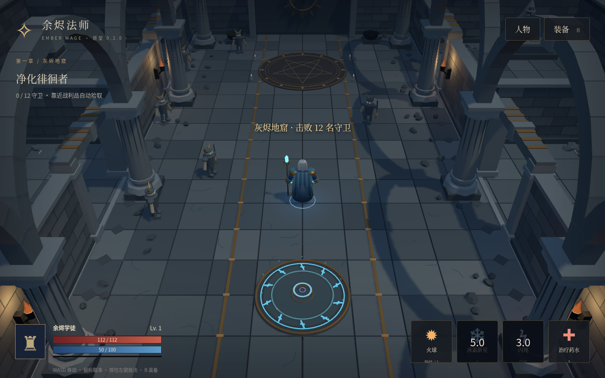

# 余烬法师 · Ember Mage

**版本 0.2.0** · 原创暗黑风格的 3D 网页单人刷怪原型。第一版专注法师，支持电脑与手机浏览器。

[打开游戏](https://templehao.github.io/Diablo/) · [完整游戏策划](docs/bible/README.md) · [在线策划阅读版](https://templehao.github.io/Diablo/design/) · [部署工作流](https://github.com/TempleHao/Diablo/actions/workflows/pages.yml)

游戏地址需要 GitHub Pages 工作流成功部署后才可访问；以工作流结果为准。

## 完整故事与策划纲领

《余烬纪事》策划基线1.0已整理成[分章文档](docs/bible/README.md)、[完整Markdown](docs/GAME-BIBLE-1.0.md)与[PDF](dist/design/GAME-BIBLE-1.0.pdf)。源章节约11.0万汉字，覆盖五幕故事、法师三系、装备与词条、关卡与怪物、掉落打造、终局和未来在线扩展，并给出美术技术规范及验证方法。它是完整设计提案，与当前Demo实际能力分别标注。



## 当前可玩内容

- 法师 3D 模型：银发、面部、分层衣袍、护肩、腰带、靴子与水晶法杖；待机、行走、施法骨骼动作，可打开人物面板拖动旋转查看。
- 灰烬地窟：石砖大殿、互通侧室、立柱、拱廊、火把、祭坛与环境装饰，场景碰撞配合可走区域。
- 火球远程攻击、冰霜新星范围伤害与减速、闪现、冷却式治疗药水。
- 12 名守卫与灰烬领主、三种品质随机法杖、升级、换装与分解。
- 本机存档保留等级、装备、通关次数；死亡保留已拾取成长，通关后下一轮敌人和掉落提高。
- 手机左侧摇杆移动、右侧技能按钮；按住火球连续攻击，自动瞄准最近敌人。电脑支持键鼠。

## 操作

| 操作 | 电脑 | 手机 |
| --- | --- | --- |
| 移动 | WASD / 方向键 | 左侧摇杆 |
| 火球 | 鼠标瞄准，按住左键或 1 | 按住火球 |
| 冰霜新星 | 2 | 冰霜按钮 |
| 闪现 | 空格 | 闪现按钮 |
| 药水 | 3 | 药水按钮 |
| 装备 | B / 装备按钮 | 装备按钮 |
| 人物查看 | 人物按钮，拖动旋转 | 人物按钮，拖动旋转 |

建议手机横屏。页面需要 WebGL；所有游戏运行资源都随仓库部署，不依赖外部 CDN。

## 本地启动

需要 Python 3、Node.js 和支持 WebGL 的浏览器，不需要安装 npm 依赖。

```sh
npm run dev
# 浏览器打开 http://localhost:5173
npm run check
```

## 模型源文件

`dist/models/ember-mage.glb` 是游戏使用的模型，包含 9 个骨骼与 Idle、Walk、Cast 动作。`scripts/build-mage.py` 是可复现的原创 Blender 建模脚本。

使用 Blender 4.3.2 生成 GLB 与可编辑的 `.blend` 文件：

```sh
blender -b --python scripts/build-mage.py -- /你的绝对路径/Diablo
```

生成的 `.blend` 位于 assets-source，默认不提交；源码包另附原生模型。游戏模型采用风格化造型，尚不是正式写实美术。

## GitHub Pages 部署

仓库 Settings → Pages → Build and deployment 的 Source 选择 GitHub Actions。推送 main 后 Deploy GitHub Pages 工作流发布 dist；也可以在 Actions 手动运行。资源使用相对路径，适配 `/Diablo/` 子路径。

## 仍待实现

完整房间关卡、分工怪物 AI、三系构筑、真实词条组合、定向掉落与重铸仍属于[设计计划](docs/bible/README.md)，目前不是现有能力。完整计划为十装备位，D1先做六槽过渡。当前地图是固定场景，怪物位置和法杖数值随机；法杖还只有伤害加成。

暂不提供账号、云存档、多人联机或交易。本机存档不跨域名/设备共享；清除网站数据会丢失存档。真实手机性能与完整 Boss 通关平衡仍需持续测试。

## 第三方声明

Three.js 0.170.0 及其 GLTFLoader、BufferGeometryUtils、SkeletonUtils 使用 MIT 许可证，见 THREE-LICENSE.txt 与 dist/vendor/THREE-LICENSE.txt。本项目未为原创代码、模型或美术选定许可证。

## 验证记录

Chromium 桌面与手机视口检查覆盖模型加载、三段骨骼动画、移动和技能、人物查看与拖动、装备加成、刷新恢复存档。`npm run check` 检查语法和模型资源完整性。桌面自动化渲染结果不能代替真实手机帧率测试。
